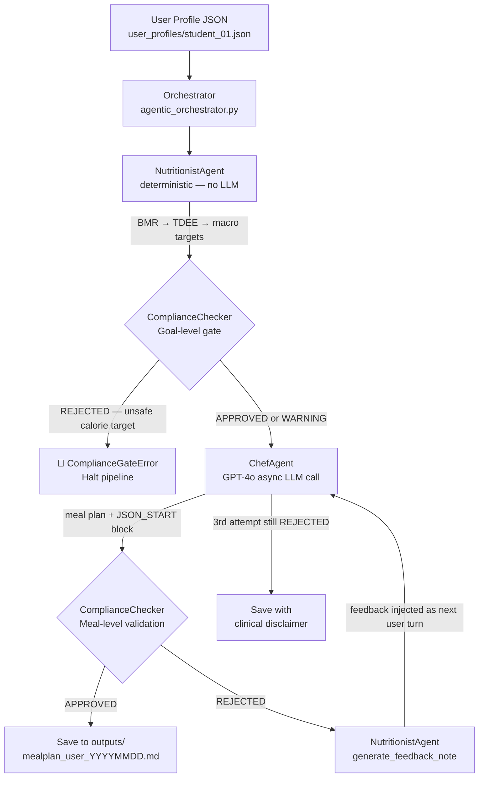

# NutriNav-AI — Nutritional Agentic Pipeline

A multi-agent Python system that produces personalised, clinically-safe 1-day meal plans. A deterministic **Nutritionist Agent** computes calorie and macro targets from biometrics; a **Chef Agent** uses GPT-4o to invent original recipes that hit those targets exactly; a self-correcting feedback loop retries the Chef up to three times if the plan fails compliance checks.

---

## Architecture



The Chef retry is a **multi-turn conversation** — each rejected attempt appends the Chef's output and the Nutritionist's feedback note to the message history before calling the LLM again. The model sees its own previous mistake alongside the correction.

---

## Directory Structure

```
nutrinav-ai/
│
├── agents/
│   ├── agentic_orchestrator.py   # Orchestrator class + CLI entry point
│   ├── nutritionist_agent.py     # Deterministic: BMR → TDEE → macros + feedback
│   ├── chef_agent.py             # LLM: invents recipes, enforces structured output
│   └── prompts.py                # ALL prompt templates — edit here only
│
├── tools/
│   ├── calculate_daily_calories.py   # Mifflin-St Jeor calculator (no LLM)
│   ├── compliance_checker.py         # USDA/WHO safety validator
│   ├── nutrition_api.py              # Optional USDA FoodData Central client
│   └── unit_converter.py            # Metric ↔ imperial; injects table into Chef prompt
│
├── user_profiles/                # Individual JSON profiles (pipeline input)
│   ├── student_01.json
│   ├── student_02.json
│   └── student_03.json
│
├── outputs/                      # Generated meal plans (auto-created)
│   └── mealplan_<user_id>_<YYYYMMDD>.md
│
├── .env                          # API keys — never commit this
└── requirements.txt
```

---

## Setup

### 1. Install dependencies

```bash
pip install -r requirements.txt
```

### 2. Configure environment variables

Create a `.env` file in the project root:

```
OPENAI_API_KEY=sk-...         # required
USDA_API_KEY=...              # optional — enables NutritionistAgent.validate_ingredient()
OPENAI_MODEL=gpt-4o           # optional — defaults to gpt-4o
```

> **Why GPT-4o?** The Chef prompt must simultaneously satisfy calorie targets, macro ratios, dietary framework rules, and allergy constraints in a single structured response. Smaller models (gpt-3.5-turbo, gpt-4o-mini) reliably fail at least one constraint. GPT-4o or Gemini 1.5 Pro is the minimum. 
---

## Running the Pipeline

### Generate a meal plan

```bash
# Basic run
python -m agents.agentic_orchestrator user_profiles/student_01.json

# Specify a model
python -m agents.agentic_orchestrator user_profiles/student_01.json --model gpt-4o-mini

# Custom output directory
python -m agents.agentic_orchestrator user_profiles/student_01.json --output-dir my_plans
```

The finished plan is saved to `outputs/mealplan_<user_id>_<YYYYMMDD>.md` and printed to stdout.


### Use the Orchestrator programmatically

```python
import asyncio
from agents.agentic_orchestrator import Orchestrator

# Async
async def main():
    orch = Orchestrator(api_key="sk-...", model="gpt-4o")
    result = await orch.run("user_profiles/student_01.json")
    print(result["status"])     # "APPROVED" | "WARNING" | "REJECTED"
    print(result["output_path"])

asyncio.run(main())

# Sync convenience wrapper
result = Orchestrator.run_sync("user_profiles/student_01.json")
```

### Smoke-test tools (no API key needed)

```bash
python tools/compliance_checker.py   # runs 3 built-in validation scenarios
python tools/unit_converter.py
```

---

## User Profile Schema

```json
{
  "user_id": "student_01",
  "biometrics": {
    "age": 28,
    "weight_kg": 91,
    "height_cm": 180,
    "gender": "male",
    "activity_level": 1.55
  },
  "goals": {
    "target": "lose_weight",
    "weekly_rate_kg": 0.5
  },
  "preferences": {
    "dietary_framework": "high protein",
    "liked_foods": ["chicken", "eggs", "spinach"],
    "disliked_foods": ["pork"],
    "allergies": ["none"]
  }
}
```

`activity_level` follows the standard PAL multipliers (1.2 sedentary → 1.9 very active). `target` accepts `lose_weight`, `gain_weight`, or `maintain_weight`.

**Supported dietary frameworks:** `keto`, `vegan`, `vegetarian`, `paleo`, `carnivore`, `pescatarian`, `mediterranean`, `high protein`, `low-lectin`, `whole30`, `dash`, `fodmap`. Aliases like `"high-protein"` and `"plant-based"` are resolved automatically.

---

## Agent Responsibilities

| Agent | LLM? | Input | Output |
|-------|------|-------|--------|
| **NutritionistAgent** | No | User profile JSON | Calorie target, macro targets (g), compliance report, Chef constraint block |
| **ChefAgent** | Yes (GPT-4o, async) | Nutritionist constraint block + user preferences | Full 1-day meal plan in Markdown + `[JSON_START]…[JSON_END]` compliance block |
| **ComplianceChecker** | No | Calorie target or meal `daily_totals` dict | `ComplianceReport` with `status`, `issues`, and `suggestions` |

### Compliance rules enforced

| Check | Threshold | Outcome |
|-------|-----------|---------|
| Calorie floor | < 1,200 kcal (F) / 1,500 kcal (M) | `REJECTED` |
| Weekly loss rate | > 1.0 kg/week | `REJECTED` |
| Weekly gain rate | > 0.5 kg/week | `WARNING` |
| Protein (IOM AMDR) | < 10% or > 35% of kcal | `REJECTED` |
| Keto carb ceiling | > 50 g/day | `REJECTED` |
| Sodium (USDA) | > 2,300 mg/day | `REJECTED` |
| Saturated fat (USDA) | > 10% of kcal | `REJECTED` |
| Added sugar (WHO) | > 10% of kcal | `REJECTED` |

---

## Error Reference

| Error / Exit code | Meaning | Fix |
|---|---|---|
| `ProfileLoadError` / exit 1 | Profile JSON missing or malformed | Check the file path and JSON syntax |
| `ComplianceGateError` / exit 2 | Calorie target is clinically unsafe | Lower `weekly_rate_kg` (max 1.0 for loss) |
| `ChefGenerationError` / exit 3 | OpenAI API error on all 3 attempts | Check `OPENAI_API_KEY`; try `--model gpt-4o-mini` |
| `NutriNavError` / exit 4 | I/O failure writing output file | Check write permissions on `outputs/` |
| `AuthenticationError` | Wrong API key | Verify `.env` contains a valid `OPENAI_API_KEY` |
| `RateLimitError` | API quota hit | Wait 60 s or switch to `--model gpt-4o-mini` |
| Chef output missing JSON block | Model didn't follow format | Re-run; persistent failures suggest too small a model |
